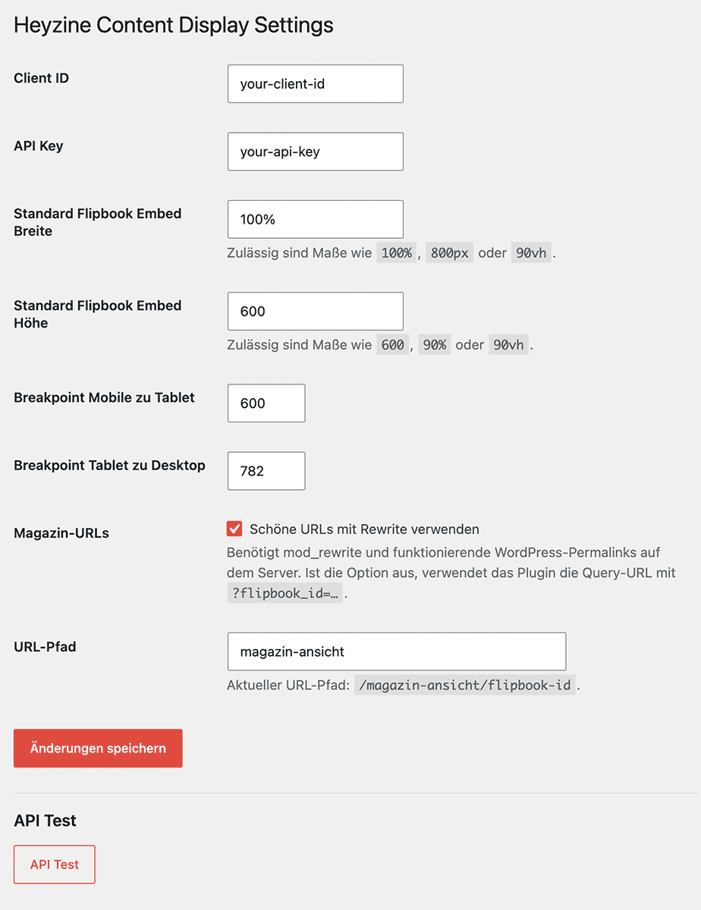
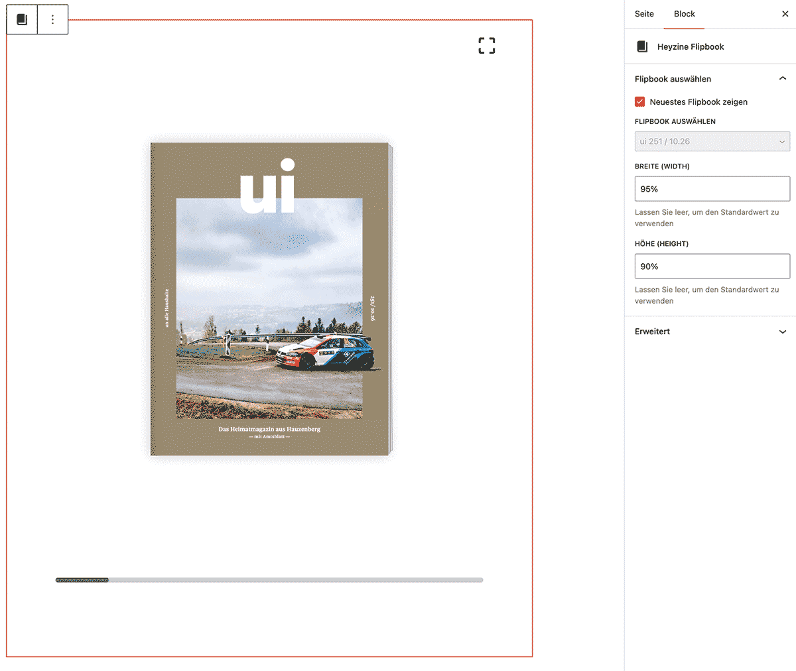
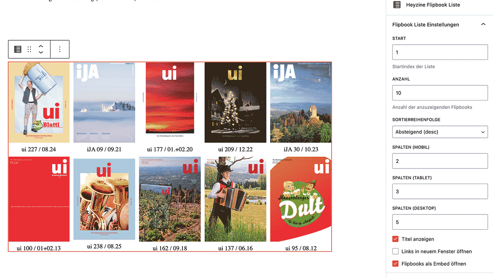

# Heyzine Content Display

Embed Heyzine flipbooks in WordPress, display configurable flipbook lists, and manage them with Gutenberg blocks.

## Features

- Gutenberg blocks for a single flipbook and a flipbook list
- Shortcodes for the newest flipbook and flipbook lists
- Configurable embed dimensions
- Internal flipbook pages with a configurable URL path, or query-string URLs as a fallback
- HTTPS embed URLs restricted to `heyzine.com` and `www.heyzine.com`
- English and German plugin interface translations

## Languages

The plugin interface is available in English and German. English is the default; WordPress selects the translation based on the site language, with a user's profile language taking precedence in the admin area when set. The screenshots below show the German interface.

## Requirements

- A WordPress site with the block editor
- A Heyzine API key
- Outbound HTTPS access from WordPress to `heyzine.com`
- For pretty URLs: working WordPress permalinks and Apache `mod_rewrite` (or equivalent rewrite support)

The plugin can register WordPress rewrite rules, but it cannot enable `mod_rewrite` in the web server. If rewrite support is unavailable, turn off **Use pretty URLs** in the plugin settings; flipbook links will then use `?flipbook_id=…`.

## Installation

1. Copy the `heyzine-content-display` folder into `wp-content/plugins/`.
2. Activate **Heyzine Content Display** in WordPress under **Plugins**.
3. Open **Settings → Heyzine Content Display** and configure the Heyzine API credentials.
4. Add one of the plugin's blocks to a page or post, or use a shortcode.

The site must be able to contact Heyzine over HTTPS to retrieve flipbook data. The plugin fetches the current list when a flipbook block or shortcode is rendered.

## Settings

Under **Settings → Heyzine Content Display**, you can configure:

- Heyzine Client ID and API key
- Default embed width and height
- Breakpoints used in the Gutenberg flipbook-list preview
- Whether to use pretty URLs
- The path segment for pretty URLs (default: `magazin-ansicht`)

Supported dimensions are positive numbers with an optional unit: `%`, `px`, `vh`, `vw`, `rem`, or `em`. Examples: `95%`, `600`, `800px`, `90vh`. The plugin validates dimensions and falls back to its defaults when a value is invalid.

The URL path is sanitized to a single slug. Changing the path or URL mode triggers a rewrite-rule refresh automatically.



## Gutenberg blocks

### Heyzine Flipbook

Choose a flipbook or enable **Show newest flipbook**. You can override the default width and height for that block; leave either field empty to use the plugin-wide default.



### Heyzine Flipbook List

Configure the list's start position, item count, order, responsive columns, titles, link target, and whether flipbooks open in an internal embed page. The list links use the plugin's selected URL mode.



## Shortcodes

Display the newest flipbook:

```text
[display_heyzine_newest]
```

Display a flipbook list:

```text
[display_heyzine_list start="0" count="10" order="desc" columns_mobile="2" columns_tablet="3" columns_desktop="5" show_titles="1" open_in_new_window="1" open_on_site_embed="1"]
```

List shortcode options:

| Attribute | Default | Description |
| --- | --- | --- |
| `start` | `0` | Number of items to skip before displaying the list |
| `count` | `10` | Maximum number of flipbooks to display |
| `order` | `desc` | Date order: `desc` (newest first) or `asc` |
| `columns_mobile` | `2` | Columns on mobile screens |
| `columns_tablet` | `3` | Columns on tablet screens |
| `columns_desktop` | `5` | Columns on desktop screens |
| `show_titles` | `0` | Show flipbook titles (`1` or `0`) |
| `open_in_new_window` | `0` | Open external links in a new tab (`1` or `0`) |
| `open_on_site_embed` | `0` | Open flipbooks on the WordPress site (`1` or `0`) |

When `open_on_site_embed` is enabled, pretty URLs look like `/magazin-ansicht/flipbook-id/` by default. With pretty URLs disabled, the link uses `/?flipbook_id=flipbook-id`.

## Development

The Gutenberg editor script is maintained in `blocks/index.js` and loaded directly by the plugin. There is no separate `src/` directory or generated `build/` output, so edit this file directly.

## Troubleshooting

- **Pretty URL returns 404:** Check that rewrite support is enabled by the web server and that WordPress permalinks work. As a fallback, disable **Use pretty URLs** and use the query-string route.
- **No flipbooks appear:** Check the Heyzine API credentials and the site's outbound HTTPS access. Use the **API Test** button on the plugin settings page.
- **An embed URL is rejected:** Only HTTPS URLs hosted on `heyzine.com` or `www.heyzine.com` are accepted.

## Security and credentials

The API key is stored in the WordPress options database by default and is visible to users who can manage site settings. Do not commit API keys, database exports, or production configuration containing secrets to GitHub. For stronger separation from the database, a future configuration can load the key from a server environment variable or a constant in `wp-config.php`; the plugin currently reads the key from its WordPress setting.

The settings page and API test require the `manage_options` capability. The Gutenberg flipbook-list request requires `edit_posts` and a WordPress nonce.

## License

GPL-2.0-or-later.
